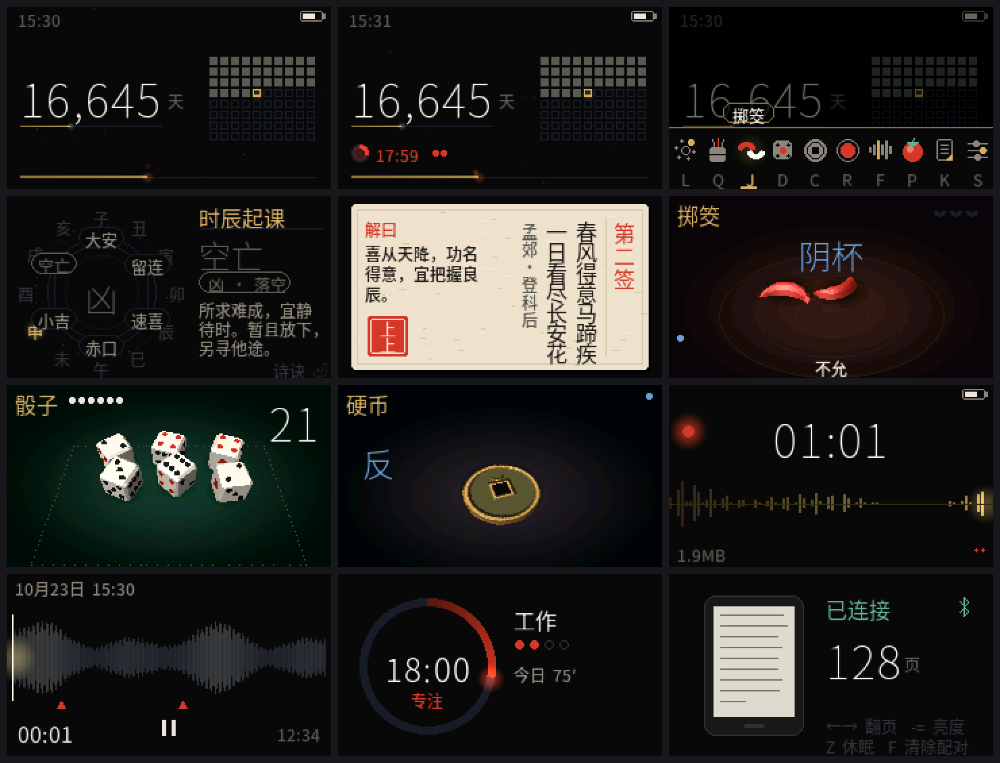

# TianJi 天机

**Firmware for the M5Stack Cardputer ADV: a life countdown, Chinese divination toys (小六壬 / fortune sticks / 掷筊), 3D dice and coin, long SD-card voice recorder, pomodoro timer and a Kindle page turner.**

[中文](README.md) · [Engineering notes](docs/NOTES.md) · [Third-party notices](NOTICE.md)



<sub>Rendered on a computer by `tools/preview` with the **same UI code** the firmware runs (not photos of the device). The screen is 240×135.</sub>

## Features

- **Home / "remaining life"** — one big number (days left) and everything else told through motion: a line that shortens through the day, a grid of years whose current cell fills up and breathes with the seconds, and a life bar that sheds an ember every second. A running pomodoro shows up here too.
- **小六壬** (lunar month / day / double-hour counting around six palaces; or count three numbers you pick) with vertical verses. Lunar calendar 1900–2100, table generated from ICU and verified day by day.
- **Fortune sticks** — 3D bamboo tube, 64 slips (classical poetry couplets with a reading and five life aspects).
- **掷筊** — two crescent blocks with rigid-body physics: 圣杯 / 笑杯 / 阴杯.
- **Dice** (1–6, chamfered, grid layout) and a **bronze coin** with relief lighting.
- **Hold-to-charge throws** — hold Space and release, or shake the device (IMU).
- **Recorder** — one-key global start/stop (**G0** or **Ctrl+R**; **Fn+1/2/3** pick a preset), WAV streamed to the SD card for hours (header refreshed every 5 s, auto-continues before the 4 GB FAT32 limit), scrolling waveform, automatic dimming → screen off → 80 MHz CPU while recording, markers. A library with waveform playback and delete.
- **USB drive mode** — plug into a computer and the SD card shows up as a USB drive for quick copying; eject on the computer and the device returns to normal.
- **Pomodoro** — editable presets (Work / Reading / Study / Deep Work…), focus/break/long-break lengths, screen-off while focusing, log to `/POMO/focus.csv`, 7-day stats and streak.
- **Kindle page turner** — appears to the Kindle as a *Kindle Click* (BLE HID, Amazon VID 0x0171 / PID 0x0443): page turn, brightness, sleep. Bluetooth only runs on that screen and can be disabled in Settings.
- NTP time sync (WiFi switches itself off right after), time zone, brightness, volume.

## Quick start

**Flash a prebuilt image** — download `tianji-*-merged.bin` from [Releases](../../releases) and write it at address `0x0`:

```bash
pip install esptool
esptool --chip esp32s3 --port <serial port> write_flash 0x0 tianji-merged.bin
```

(or use the browser tool [esptool-js](https://espressif.github.io/esptool-js/); hold **G0** while plugging in USB to enter download mode).

**Build from source** with [arduino-cli](https://arduino.github.io/arduino-cli/):

```bash
arduino-cli config add board_manager.additional_urls https://static-cdn.m5stack.com/resource/arduino/package_m5stack_index.json
arduino-cli core update-index
arduino-cli core install m5stack:esp32@3.3.7
arduino-cli lib install M5Cardputer@1.1.1 M5Unified@0.2.17 M5GFX@0.2.22

./build.sh                    # compile into build/
./build.sh upload <port>      # compile and flash
```

The glyph table `tianji/fontdata.cpp` is committed, so no font is needed to build. To regenerate it after changing UI text, install Pillow, download [Source Han Sans](https://github.com/adobe-fonts/source-han-sans) (variable OTF) and set `SOURCE_HAN_SANS=/path/to/font.otf` (see `tools/mkfont.py`).

**First run:** press **S** for Settings and enter the date/time and your birthday (there is no battery-backed clock). Recording and pomodoro stats need a **FAT32** SD card.

## Keys

Home: arrows/Enter open the dock; letters jump straight in — **L** 小六壬, **Q** sticks, **J** 掷筊, **D** dice, **C** coin, **R** recorder, **F** library, **P** pomodoro, **K** page turner, **S** settings, **U** USB drive. **Esc** goes home from anywhere. The throwing screens use **hold Space** to charge, release to throw; dice count is **1–6**. In the page turner: arrows/Space turn pages, **- / =** brightness, **Z** puts the Kindle to sleep, **F** twice forgets the pairing. See the Chinese README for the full table.

## Status

- **Verified on a real Cardputer ADV:** build and flash; recording to the SD card producing real audio; the SD card enumerating as a USB drive on macOS; NTP sync and WiFi shutdown; Bluetooth stack start/stop with the RAM given back; frame timings of every 3D scene ([notes](docs/NOTES.md)).
- **Not yet verified:** pairing and page turns with a **real Kindle**. The protocol is ported from a [reference implementation that works on real Kindles](https://github.com/zuyan9/Open-Kindle-Click-ESP32-C6), but this firmware hasn't been tried against one.
- **Limitation:** the Bluetooth stack and WiFi / recording / speaker don't fit in RAM together, so Bluetooth only runs while the page-turner screen is open.

## Credits

See the [Chinese README](README.md#致谢与参考) and [NOTICE.md](NOTICE.md): [Wenston-dev/omarchy-memento](https://github.com/Wenston-dev/omarchy-memento) (the "remaining life" idea), [KyleBing/m5stack-cardputer-sparks](https://github.com/KyleBing/m5stack-cardputer-sparks), [zuyan9/Open-Kindle-Click-ESP32-C6](https://github.com/zuyan9/Open-Kindle-Click-ESP32-C6) (MIT, the page-turner code is adapted from it), [zuyan9/Open-Kindle-Click-nRF52840](https://github.com/zuyan9/Open-Kindle-Click-nRF52840) (protocol notes), [zuyan9/Flipper-Zero-Kindle-Click](https://github.com/zuyan9/Flipper-Zero-Kindle-Click), [Cardenza-Community/cardputer-studio](https://github.com/Cardenza-Community/cardputer-studio) (ES8311 settings), [Tombotronic/audio-spy](https://github.com/Tombotronic/audio-spy), the M5Stack libraries, and Adobe's Source Han Sans (OFL).

## License

[MIT](LICENSE). Third-party material: [NOTICE.md](NOTICE.md), [licenses/](licenses/).
